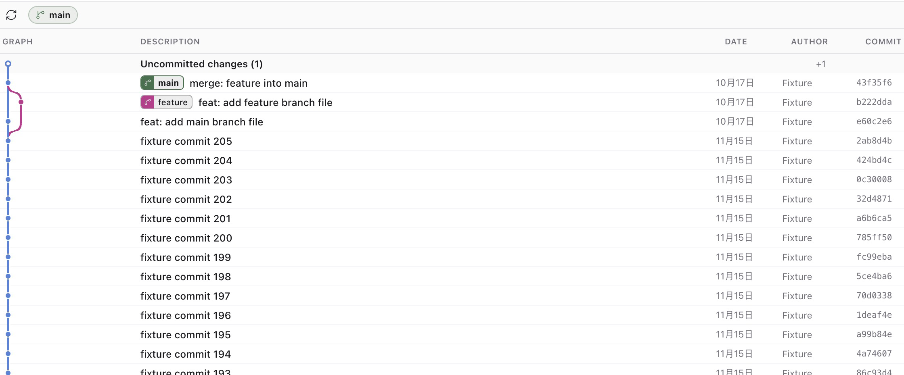

# Paseo Git Graph

Read-only Git history for the current Paseo workspace.



## Open it

1. Open a Git-backed Paseo workspace.
2. Open the main tab-strip `+` menu.
3. Choose **Git Graph**.

The panel binds to that workspace automatically. It has no repository picker.

## What it shows

- Local branches, remote-tracking branches, tags, `HEAD`, dates, authors, and short commit IDs.
- Continuous curved lanes for forks, merges, and octopus merges, including the working-tree connector.
- The current working-tree change row when the checkout is dirty.
- An inline file summary when a commit is clicked.
- A unified patch when a changed file is clicked.
- 200 commits initially. Reaching the end of the loaded list requests the next 200. There is no total commit limit.

Remote-tracking refs are values already stored in the local repository. Opening or refreshing the panel never runs `git fetch`.

## Read-only boundary

The plugin resolves the active workspace to its Git worktree and runs bounded read-only Git commands. It does not expose checkout, merge, rebase, reset, cherry-pick, revert, branch deletion, tag creation, stash, fetch, pull, push, or file editing.

Patches are loaded only when a file row is opened. Binary files show a binary marker instead of a textual patch.

## Development

```sh
npm install
npm run typecheck
npm test
```

Install the local directory into the selected Paseo daemon:

```sh
paseo plugin install /absolute/path/to/paseo-git-graph
paseo plugin ls
```

## Provenance

Lane allocation follows the MIT-licensed [`zfhuang/paseo-git-tree`](https://github.com/zfhuang/paseo-git-tree) layout algorithm. See [THIRD_PARTY_NOTICES.md](THIRD_PARTY_NOTICES.md).

The curve sampling, lane rendering, ref pills, and panel UI are an original implementation written for Paseo.

Paseo plugin code is trusted and unsandboxed. Install it only from a source you have reviewed.
